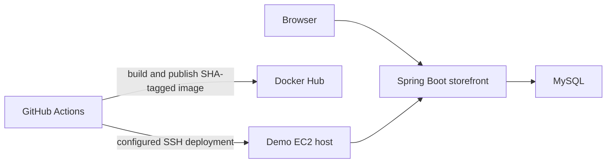

# Kien Shop Cart

A small, English-language shopping-cart application and DevOps portfolio project. The storefront is a clean reimplementation of common shopping-cart behavior; the repository also contains Docker, CI, deployment, and Terraform examples. The app is for learning and demo data only, not production commerce.

## What it demonstrates

| Area | Implementation | Current evidence |
| --- | --- | --- |
| Application | Java 21, Spring Boot, Spring MVC, Thymeleaf, Spring Data JPA, MySQL | Local Gradle build and 17 Java tests pass, including a MySQL integration test |
| Cart behavior | Browse catalog; add, increase, decrease, remove, and clear cart lines; calculate subtotal | Service and controller unit tests |
| Quality | Service/controller unit tests, MySQL Testcontainers integration test, JaCoCo coverage verification, and Python deployment-script tests | 100% measured line coverage locally; 95% gate; run `./gradlew clean test jacocoTestCoverageVerification` |
| Container | Multi-stage Docker build, non-root runtime, liveness health check, Compose app/database setup | Compose, readiness, home page, cart add, and non-root identity verified locally |
| Delivery | Commit-SHA Docker image tags, CI checks, security scanning, EC2 deploy script with readiness check and rollback | Configuration exists; no GitHub Actions run or real AWS deployment verified |
| Infrastructure | Terraform example for a demo EC2 host and budget notification | Do not apply without reviewing the plan, access rules, and cost |

**CV-ready summary:** Reimplemented a server-rendered shopping-cart demo with Java 21, Spring Boot, and MySQL; added Docker Compose, MySQL-backed integration tests, CI security checks, and an EC2 deployment/rollback example. Verified 17 Java tests and 100% measured line coverage locally. Describe the AWS deployment as configured, not live, until you personally run and verify it.

This is a fixed demo cart, not a multi-user shopping service. It has no authentication, checkout, payment processing, inventory controls, order management, or production hardening. The database sample credentials in Compose are local-only.

## Architecture



## Run locally

Prerequisites: Java 21, Docker, and Docker Compose v2.

```sh
docker compose up --build -d
curl -fsS http://localhost:8080/actuator/health/readiness
curl -fsS http://localhost:8080/
docker inspect --format '{{.State.Health.Status}} {{.Config.User}}' "$(docker compose ps -q app)"
```

Expected: readiness reports `UP`, the storefront responds with HTTP 200, and the container reports `healthy 10001`. Open [http://localhost:8080](http://localhost:8080) in a browser to exercise the cart.

The Compose database initializes from `src/main/resources/db/re_shopping_cart_db.sql` only when its data volume is first created. Compose now uses the `kien-shop-cart-data` volume so a fresh run does not reuse an old project schema. Do not remove a volume if you need its data. To intentionally reset only this demo database, stop Compose and review the exact volume before using `docker volume rm`.

Stop the local services with:

```sh
docker compose down
```

## Run checks

```sh
./gradlew --no-daemon clean test jacocoTestCoverageVerification
python3 -m unittest discover -s deploy/tests -v
bash -n deploy/deploy.sh
```

The MySQL Testcontainers integration test is skipped when Docker is unavailable. A green run without Docker still does not verify persistence integration.

## CI/CD and AWS

The GitHub Actions workflows are templates/configuration, not proof of a successful release. Tests and security scans run on pull requests and pushes to `main`. Image publishing and deployment are disabled by default; enable them only after setup:

1. Review [the runbook](docs/RUNBOOK.md), [Terraform notes](infra/README.md), and current AWS pricing.
2. Create and secure an owner-controlled Docker Hub repository named `kien-shop-cart`.
3. Configure the `production` environment secrets listed in the runbook, then set the repository variable `ENABLE_DEPLOY` to `true`.
4. Ensure SSH access is limited to a trusted, stable runner egress address. Do not open SSH globally to accommodate GitHub-hosted runners; consider a self-hosted runner with controlled egress or an AWS Systems Manager design.
5. Review a Terraform plan and expected cost yourself before any apply. No AWS resources were created or modified as part of this rewrite.
6. After a real deployment, verify readiness, the home page, and cart operations; record the Action run and rollback evidence in `docs/EVIDENCE.md`.

The deployment uses a single host and can have downtime during container replacement. Terraform may create billable resources; its budget alert is not a spending cap.

## Attribution and project history

The application source, templates, CSS, and sample database content in this repository were newly implemented for this clean rewrite; the app does not reuse the previous app's Java files or product images. The project still uses open-source dependencies, including Spring Boot, Thymeleaf, MySQL Connector/J, and Gradle.

This new repository starts with a clean snapshot and does not carry over the previous repository's commit history. That does not change the provenance of earlier work or establish publication rights for material outside this rewrite. This implementation was AI-assisted; understand, verify, and be prepared to explain every part before describing it on a CV.

No license has been added. Choose a license after reviewing the dependencies and confirming the right to publish every included file.

## Documentation

- [Current findings and limitations](docs/FINDINGS.md)
- [Architecture decisions](docs/DECISIONS.md)
- [Deployment runbook](docs/RUNBOOK.md)
- [Verification evidence and owner TODOs](docs/EVIDENCE.md)
- [Terraform setup and cost warning](infra/README.md)
- [Security policy](SECURITY.md)
